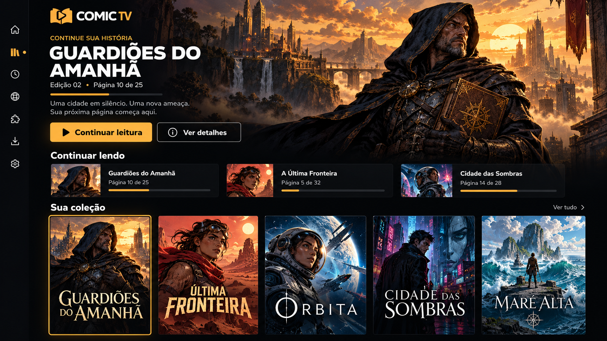

# Design final aprovado — Comic TV

Registrado em 24/10/2026 por solicitação explícita do usuário.

## Referência vinculante

A imagem define a composição final: lateral estreita, logo no alto, destaque com fundo visual e ação de continuar, leituras recentes compactas e coleção com capas grandes. Implementar em Compose nativo; não substituir por uma recoloração dos antigos painéis.

## Identidade oficial

O usuário forneceu duas artes posteriores à proposta. brand_symbol.jpg é o símbolo oficial; brand_wordmark.jpg é a assinatura COMIC TV com sua tipografia. Essa identidade tem precedência sobre o símbolo provisório da proposta. Nenhum arquivo de fonte TTF/OTF foi fornecido; preservar a tipografia da assinatura na própria arte.

A assinatura com texto também serve de fundo padrão da página principal e alternativa quando o fundo com capa desfocada está desligado.

## Requisitos permanentes

- Cores personalizáveis: amarelo, verde, azul, violeta e futuros presets.
- Alto contraste e texto ampliado preservados.
- Lateral inicia recolhida e expande ao focar ícones.
- Arte de fundo escurecida para legibilidade; capas visíveis em primeiro plano conservam proporções.
- Dados reais da biblioteca: títulos da imagem são ilustração da proposta.
- Retomada de leitura, histórico completo, confirmação de remoção e controles existentes preservados.
- Ajustes por tamanho de TV/acessibilidade devem preservar a composição aprovada.

## Refinamento após teste na TV — 0.9.1

A tela principal usa sempre a identidade Comic TV desfocada e mais escura. A opção de capa desfocada aplica-se somente aos detalhes da edição selecionada. Destaque recebe margem interna de 18 dp e separação de 14 dp do cabeçalho para afastar textos e botões das bordas.

## Temas aprovados — 0.9.2

Comic TV (dourado), Tema Flix (preto/vermelho), Tema Prime (marinho/ciano), Tema Max (índigo/violeta), Tema Cinema (preto/branco). As cores abrangem fundos, painéis, barras, botões, progresso e foco. Logo e ilustrações mantêm cores originais. Verde, azul e violeta antigos preservados para não invalidar preferências salvas.

As ações do destaque inicial (Continuar/Começar leitura e Importar) ficam neutras sem foco; a cor preenchida indica foco ou interação, evitando aparência de seleção permanente.

Cabeçalho da biblioteca: somente texto COMIC TV, usando Montserrat ExtraBold incorporada como aproximação da referência aprovada. COMIC branco e TV na cor do tema ativo; sem símbolo nem fundo retangular. Símbolo lateral e artes de fundo preservados. Fonte: https://github.com/JulietaUla/Montserrat; licença SIL OFL incluída no APK e em docs/licenses.

0.9.3: o topo da barra lateral expandida usa o mesmo cabeçalho textual Montserrat ExtraBold da biblioteca, sem imagem retangular; COMIC branco e TV na cor do tema.

Relacionados ficam abaixo da ficha, com capas e motivo explícito. Incluir biblioteca e amostra do catálogo da fonte; não inferir créditos pela sinopse. A API atual fornece principalmente escritor/desenhista; editora, personagens e direção dependem de metadados explícitos. Arquivos locais sem créditos mostram indisponibilidade. O símbolo recolhido acompanha o tema.

0.9.4: Relacionados ficam ocultos, com consultas desativadas, por solicitação do usuário. Preservar código para revisão futura. A implementação existente compara metadados sem IA. Centralizar o wordmark no menu lateral expandido; manter alinhamento do cabeçalho da biblioteca.

0.9.5: acabamento de catálogo e extensões. Capas do catálogo preservadas inteiras, com legenda de duas linhas abaixo; cabeçalho e busca rolam com a grade, mantendo restauração do item. Grades se adaptam ao texto ampliado. Extensões e fontes usam ícones compactos e cartões com altura flexível; abas distinguem seleção e foco e exibem contadores. Lista de extensões por repositório também em grade. Temas, instalação e Relacionados ocultos preservados.

0.11.0: organização integrada às telas atuais, escolha explícita do usuário. Biblioteca recebe Buscar e faixa horizontal Todas/Favoritos/coleções, mantendo destaque e Continuar lendo. Menu de OK longo e detalhes recebem favorito/coleções. Configurações recebe Armazenamento, sem nova rota lateral. Preservar os temas e o desenho aprovado; coleções manuais e limpeza de cache com confirmação.

0.12.2: acabamento da composição existente. Margens da grade de 12 dp horizontal e 16 dp vertical; separação do cabeçalho de 18 dp. Destaque com mínimo de 204 dp e padding 24/22 dp, progresso limitado a 240 dp e ações que quebram linha com texto ampliado. Recentes com padding 10 dp, capa inteira 44×64 dp e título de até duas linhas. Preservar foco, filtros, proporções das capas da coleção e fundos aprovados. Conferência visual física ainda pendente.

0.12.3: escolhas da biblioteca e Configurações compartilham TvChoice. Seleção persistente com contorno fino/texto de destaque sobre painel neutro; foco do controle com preenchimento Action e OnAction, contorno reforçado no alto contraste. As escolhas expõem selected para acessibilidade. TvButton continua responsável por ações, sem inferir seleção. Preservar cores salvas e callbacks. Conferência física dos estados visuais ainda pendente.

0.12.4: cabeçalho da biblioteca usa a escala de fonte real (Android e aplicativo). Abaixo de 760 dp × escala, a marca fica acima das ações; as ações quebram linha sem composição preguiçosa para preservar requesters. Lateral expandida cresce de 228 dp até 320 dp com a fonte; recolhida permanece 64 dp. Conteúdo lateral rolável, rótulos sem corte em uma única linha e botões com altura mínima de 52 dp. Sem mudança de rotas ou persistência. Validar D-pad/texto ampliado fisicamente antes de declarar aceitação completa.

0.12.5: correções solicitadas por fotos. Ícones do leitor distintos por modo ativo (página única, galeria com centro maior, livro aberto). Temas em grade adaptativa lado a lado. Tamanho dos textos em controle horizontal pelo D-pad,85–130% em passos5%, com porcentagem visível e Acima/Abaixo livres para navegar. Preservar preferências antigas100/115/130 e a nova porcentagem no backup.

Ainda na0.12.5: detalhes de edições online recebem Escolher capítulo / edição abaixo da ação de leitura, antes da organização. Reutilizar a lista existente, com retorno à origem (detalhes ou leitor) e capa no lugar da prévia de leitura quando não há leitor aberto. Arquivos locais não recebem sequência inventada.

1.1.14: organização visual da auditoria aprovada. Detalhes preservam leitura/capítulos/favorito, com coleções/download/histórico/exclusão em Mais opções e confirmações anteriores. Busca de fontes/extensões recolhível, filtro ativo visível e teclado somente após ativação explícita. Temas unem paleta/nome num cartão com altura mínima84dp; descrição em ajuda. Ferramentas do leitor em duas colunas de ícones52dp e legenda comum acima, com retorno ao ícone Mais opções. Capítulos reduzem intervalo10→6dp sem reduzir alvos/texto. Preservar composição principal, capa central/resumo lateral, temas, texto85–130% e originais. Verificação visual/D-pad física ainda necessária; esta etapa não comprova ganho de FPS.

1.1.17: decisão posterior por foto substitui só o dock largo do leitor: restaurar coluna única de ícones48dp, sem painel persistente, rótulo lateral somente com foco. Preservar ícones distintos, callbacks e retorno de Mais opções. Aviso passivo2s para Zoom/Mover. Cartões de tema shape8dp, menos circulares, e presets secundários Rosa/Laranja/Lima substituem a apresentação Green/Blue/Violet preservando IDs. Temas principais e composição das outras telas mantidos. Novas propostas gerais de layout aguardam pacote próprio.

1.1.20: usuário aprovou organização de Atualizações como próxima mudança visível. Resumo compacto de versões/estado, ações fixas com principal estável, progresso percentual/MiB e painel inferior rolável com foco visível para mensagens e novidades. Verificar novamente somente quando útil, com transferência de foco antes da remoção. Mensagens longas ficam no painel rolável para preservar altura de ações e leitura a130%. Preservar temas/alto contraste/texto85–130%, home/leitor e segurança do atualizador. Validação física da atualização depende da Box.

1.1.21: recorte explícito por imagem: vidro fosco somente na barra lateral e cartões Continuar lendo, fundo atual mais escuro e cantos8dp discretos. Aplicar transparência/reflexo/borda compatíveis com API26 sem backdrop vivo; alto contraste opaco. Movimento curto de opacidade da lateral e escala de ícones/recentes, sem loops, mudanças de posição/foco ou animação de dimensões. Não substituir o fundo por imagem nova nem implementar os títulos/capas fictícios da prévia. Aparência/fluidez físicas continuam manuais.
