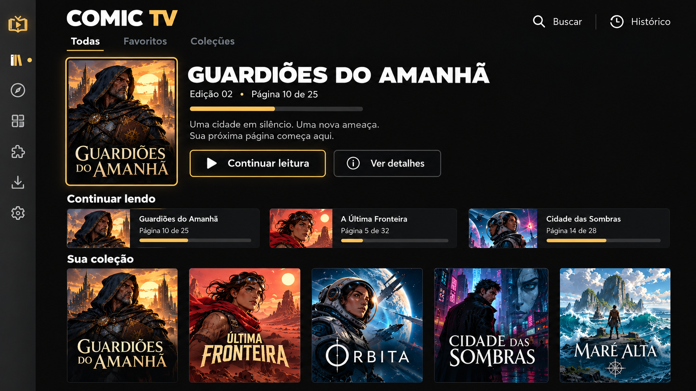
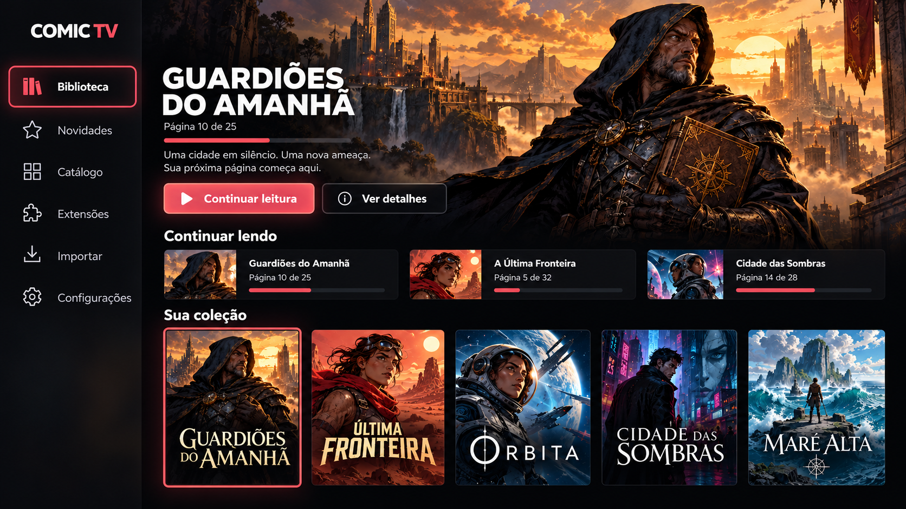
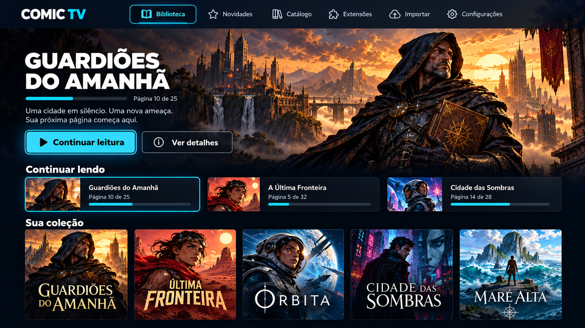
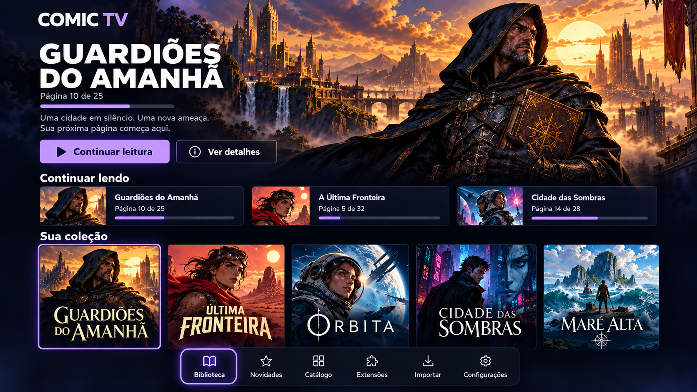
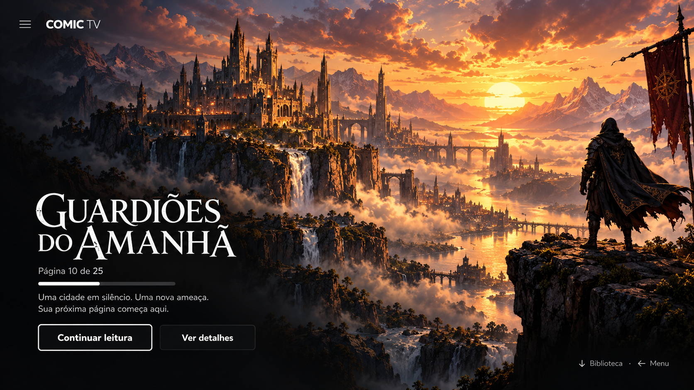

# Cinco layouts aprovados — 27/10/2026

O usuário aprovou todas as cinco prévias e pediu sua implementação e registro persistente: “perfeito,pode aprovar todos os temas e fazer a modificação” e “registrar na memoria todos os temas atualizados e replicalos conforme descritos na imagem”. Este documento e as imagens locais são a referência para a versão1.2.0 e têm precedência sobre a composição única anterior.

| Tema | Composição aprovada | Referência |
| --- | --- | --- |
| Comic TV | Estante editorial; lateral recolhível; capa vertical grande inteira à esquerda, título, progresso e ações à direita; recentes e coleção abaixo. Grafite e dourado. | [Comic TV](comic-tv.png) |
| Flix | Lateral com ícones; destaque panorâmico; fileiras de recentes e capas. Grafite com vermelho. | [Flix](flix.png) |
| Prime | Navegação horizontal superior centralizada, marca no alto à esquerda, sem lateral permanente; destaque panorâmico e fileiras abaixo. Marinho/ciano. | [Prime](prime.png) |
| Max | Dock horizontal inferior flutuante com ícones/rótulos, sem lateral permanente; destaque panorâmico e coleção acima do dock. Índigo/violeta. | [Max](max.png) |
| Cinema | Arte horizontal independente em tela cheia; título, progresso e ações na região inferior esquerda; sem navegação permanente; Menu/← abre navegação e ↓ revela biblioteca. Preto/branco. | [Cinema](cinema.png) |

## Regras comuns

- Implementação Android TV nativa com a composição e hierarquia da respectiva imagem, adaptadas ao tamanho real e à acessibilidade; cada tema troca o layout.
- As imagens são conceitos visuais, não capturas de implementação pronta. Títulos, capas e números ilustrativos não são conteúdo real da biblioteca.
- Manter todas as funções, marca oficial, capas originais, progresso, dados, USB, D-pad, foco/restauração e texto85–130%. Alto contraste pode suprimir transparência/arte para legibilidade.
- Cantos discretos8dp. Vidro80% de opacidade/20% transparência, sem reduzir alfa do texto/ícone; alto contraste100%. Não prometer desfoque óptico vivo na API26.
- Fundos neutros Comic TV/Flix/Cinema#0F0F0F; superfícies de navegação neutras#404040 e botões escuros. Prime e Max preservam suas cores.
- Lima/Rosa/Laranja deixam de aparecer; preferências e backups legados permanecem decodificáveis com retorno ao Comic TV.
- Arte horizontal manual por edição, distinta da capa, com cópia local validada e limitada. Sem busca externa nesta etapa. Imagens não entram no backup de dados; a preferência entra.

## Imagens aprovadas

